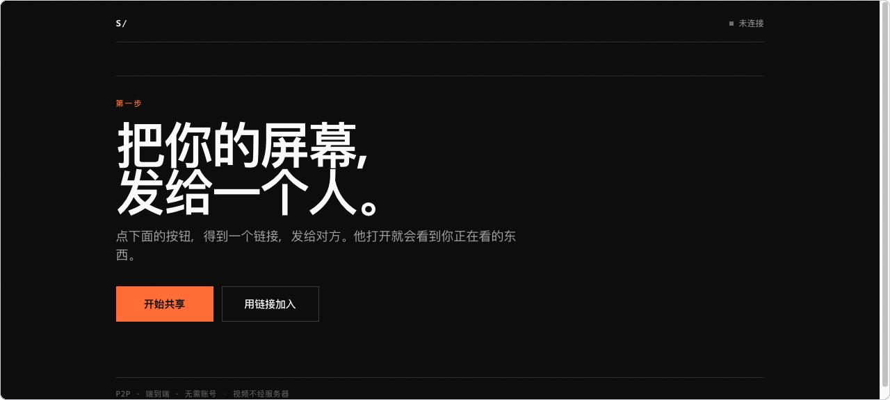
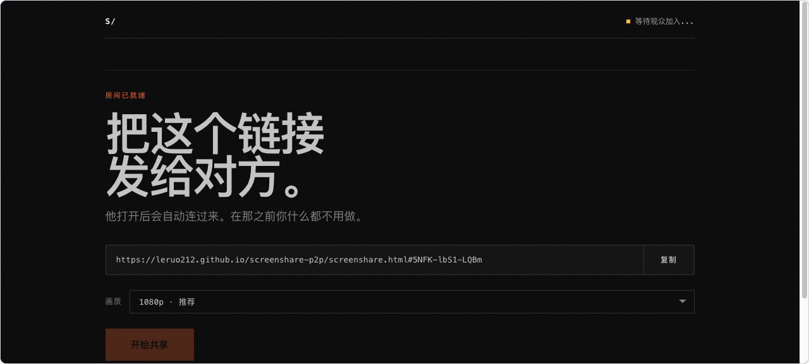

# ScreenShare P2P

Share your screen with a friend through a browser room link, using WebRTC and PeerJS. The app is statically hosted and needs no backend of your own.

[中文](README.md)

Connections use public signalling, STUN and TURN services. Media prefers a direct connection and may use a TURN relay when needed. Public-service availability and network restrictions can still prevent a session.



## Use It

Open <https://leruo212.github.io/screenshare-p2p/screenshare.html>.

1. The sharer creates a room and copies its link.
2. The viewer opens the link, or enters the displayed twelve-character room code.
3. Once connected, the sharer clicks the share control and selects a screen, window or tab in the browser prompt.
4. Stop with the stop control or close the tab.



Viewers may need to unmute playback. System audio depends on the sending browser, operating system and selected capture source.

## Browser Requirements

Use desktop Chrome or Edge for the primary workflow. Firefox capture and audio behaviour may differ. Screen capture requires `getDisplayMedia`; mobile sharing and Safari are not supported targets of this project.

## Network Architecture

```text
Browsers ←→ GitHub Pages: static application files
Browsers ←→ PeerJS public broker: connection signalling
Sharer   ←→ Viewer: direct WebRTC media when possible
Sharer   ←→ TURN relay ←→ Viewer: fallback media path
```

The configured ICE services are listed in `src/peer-flow.js`. TURN can relay encrypted media traffic; it is not correct to describe every session as server-free or direct-only.

## Access and Privacy

| Party | Access |
|---|---|
| Viewer | The selected screen content and any audio you allow |
| Signalling broker | Connection metadata, including room identifiers and IP information |
| TURN relay, when used | Relayed encrypted traffic and connection metadata |
| Anyone with the room link | Can attempt to join; there is no separate identity check |

Room codes contain twelve alphanumeric characters and are normalised to lowercase with dashes removed. They are not a 62¹²-sized case-sensitive access space. Treat the link as an access credential and share it only with intended viewers.

## Limitations and Troubleshooting

- Designed for one viewer per room; multi-viewer sessions are not a supported workflow.
- No microphone chat, remote control or recording interface.
- After stopping a share, create a new room to start another session.
- Public TURN services can be unavailable or limited. A configured relay does not guarantee a connection through every firewall.
- If the connection stalls, check both networks and the browser console for ICE or PeerJS errors. Try another network if needed.
- If video works without sound, unmute playback and check whether the sender selected an audio-capable source.
- If the page cannot find the host, check the room code and that the host's tab is still open.

## Development

```bash
npm install
npm test
npm run build
```

`build.js` generates the distributable `screenshare.html` from `screenshare.template.html` and `src/`. The deployed page is static; source changes need a rebuild.

```text
src/room-id.js         Code generation and normalisation
src/url.js             Room-link parsing
src/state-machine.js   Session states and transitions
src/constraints.js     Screen and audio capture constraints
src/peer-flow.js       PeerJS host/viewer flow and ICE configuration
src/ui-controller.js   DOM interactions
src/app.js             Application wiring
tests/                 Unit tests
```

The viewer opens a data channel first. Once the host has a stream and viewer ID, the host calls the viewer with that stream; the viewer answers without sending a local stream. Both sides use the same room normalisation, and connection attempts wait for PeerJS's `open` event.

After source edits, run the build, commit the generated page with the source changes and push to the branch used by GitHub Pages. Publication timing depends on the Pages build.

## Licence

[MIT](LICENSE)
