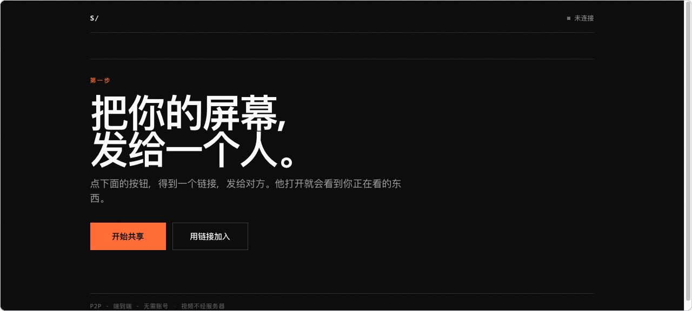
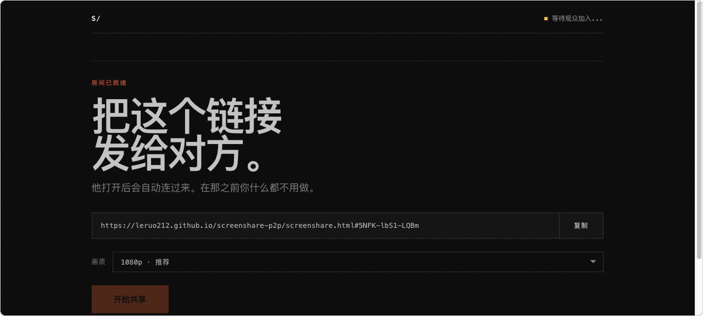

# ScreenShare P2P

给朋友发一条房间链接，在浏览器里共享屏幕。使用 WebRTC 和 PeerJS，页面静态托管，无需自建后端。

[English](README.en.md)

连接依赖公共信令、STUN 和 TURN 服务。画面优先直连，无法直连时尝试中继；公共服务的可用性和双方网络仍会影响连接结果。



## 怎么用

打开 <https://leruo212.github.io/screenshare-p2p/screenshare.html>。

1. 共享方点击“创建房间”，复制房间链接。
2. 观看方打开链接，或输入页面显示的 12 位房间号。
3. 连接后，共享方点击“开始共享”，在浏览器提示中选择屏幕、窗口或标签页。
4. 点击“停止共享”或关闭标签页即可结束。



观看方可能需要手动取消静音。系统音频能否共享，取决于发送端浏览器、操作系统和所选捕获源。

## 浏览器要求

主要使用场景是桌面 Chrome 或 Edge。Firefox 的捕获与音频行为可能不同。屏幕捕获需要 `getDisplayMedia`；手机端共享和 Safari 不在本项目支持范围内。

## 网络架构

```text
双方浏览器 ←→ GitHub Pages：静态页面
双方浏览器 ←→ PeerJS 公共 broker：交换连接信令
共享方     ←→ 观看方：可以直连时直接传输 WebRTC 媒体
共享方     ←→ TURN 中继 ←→ 观看方：无法直连时尝试的媒体路径
```

网络连接配置见 `src/peer-flow.js`。TURN 会转发加密媒体流，因此不能把所有会话都描述成“没有服务器”或“始终直连”。

## 访问与隐私

| 参与方 | 可以接触的内容 |
|---|---|
| 观看方 | 你选定的屏幕内容及授权共享的音频 |
| 信令服务 | 房间标识、IP 等连接元数据 |
| TURN 中继（使用时） | 转发的加密流量与连接元数据 |
| 持有房间链接的人 | 可以尝试加入；没有单独的身份验证 |

房间号由 12 位字母和数字组成，连接前会转成小写并去掉横线，因此不能按区分大小写的 `62¹²` 计算访问空间。请把链接当作访问凭据，只发给预期的观看者。

## 限制与排查

- 按一个房间、一名观看者设计，不支持多人会话。
- 没有麦克风语音、远程控制或录制界面。
- 停止共享后，需要重新创建房间才能开始下一次共享。
- 公共 TURN 可能不可用或受限；配置了中继也不能保证穿透所有防火墙。
- 一直连接中时，检查双方网络和浏览器控制台的 ICE、PeerJS 错误；必要时换一个网络。
- 有画面没声音时，先取消静音，再确认共享方是否选择了支持音频的捕获源。
- 找不到主机时，检查房间号和共享方标签页是否仍打开。

## 开发

```bash
npm install
npm test
npm run build
```

`build.js` 根据 `screenshare.template.html` 和 `src/` 生成可分发的 `screenshare.html`。部署后的页面是静态文件，修改源码后仍需重新构建。

```text
src/room-id.js         房间号生成与规范化
src/url.js             房间链接解析
src/state-machine.js   会话状态与转换
src/constraints.js     屏幕和音频捕获约束
src/peer-flow.js       PeerJS 主客流程与 ICE 配置
src/ui-controller.js   页面交互
src/app.js             应用装配
tests/                 单元测试
```

观看方先建立数据通道。共享方拿到屏幕流和观看方 ID 后，主动向观看方发送媒体呼叫；观看方不发送本地流，直接应答。双方使用同一套房间号规范化规则，并在 PeerJS 的 `open` 事件后尝试连接。

修改源码后，重新构建，将生成页面与源码一起提交到 GitHub Pages 使用的分支。上线时间以 Pages 构建结果为准。

## 许可证

[MIT](LICENSE)
